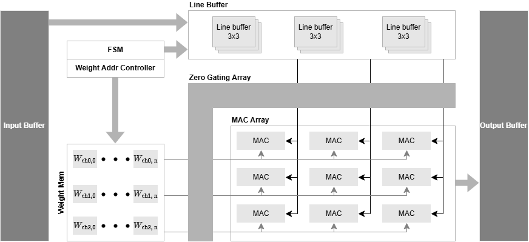
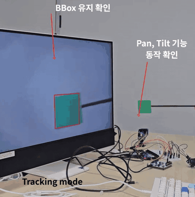
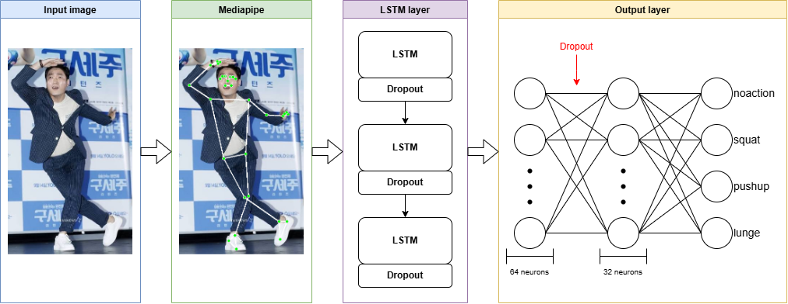
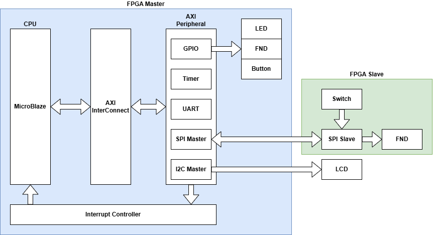
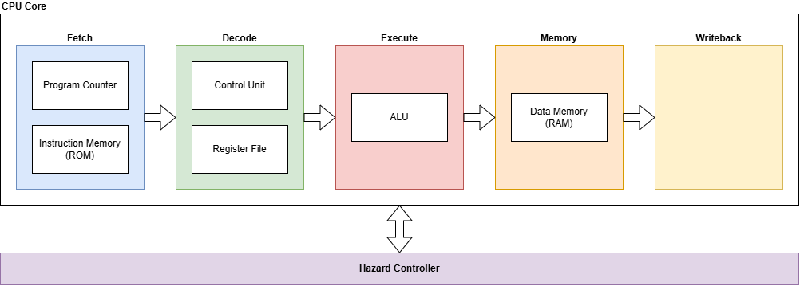
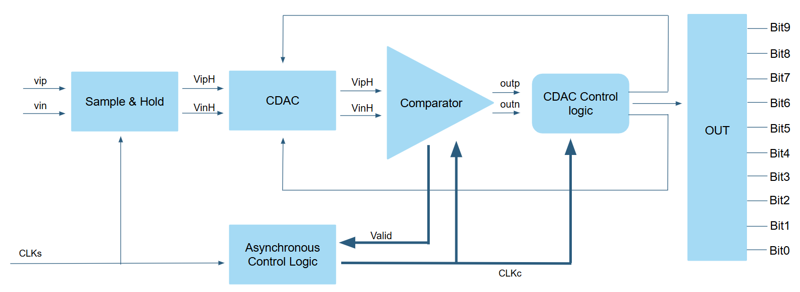
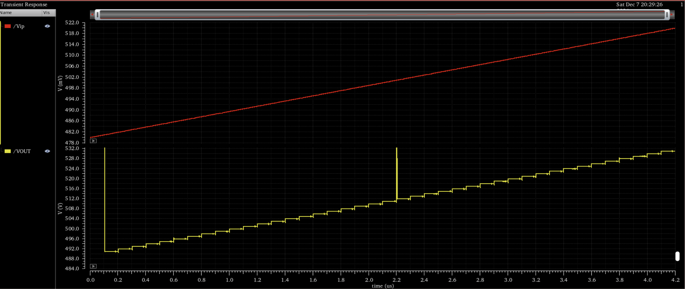

# Donghyun Kim

### RTL Design & Verification Engineer

I develop FPGA and embedded systems with a focus on RTL design and UVM-based verification. 
My work centers on digital and analog circuit design, functional verification, and hardware/software integration.

---

## Education

**Kwangwoon University** B.S. in Electronic Engineering &nbsp;|&nbsp; `2020.03 – 2026.02`

- **GPA** : 4.36 / 4.5 &nbsp;(Major **4.5 / 4.5**)
- **Coursework** : Digital Engineering, Computer Architecture, Circuit Theory
- **Projects** : 10MHz 10bit Monotonic SAR ADC · Snapshot Digital PLL
- **Clubs** : ROLAB / Trick

**On-Device AI System Semiconductor Design Program** &nbsp;|&nbsp; `2026.03 – 2026.10`

- **Projects** : CNN accelerator, RV32I CPU, AXI-based SoC, UART / FIFO design and UVM verification

---

## Skills

| Area | Details |
|:--|:--|
| **RTL Design** | SystemVerilog Verilog |
| **Verification** | UVM Functional Coverage |
| **FPGA** | Artix-7 Zynq-7020 Vivado |
| **Embedded** | MicroBlaze C |
| **Tools** | Git Vivado Simulator Virtuoso PSpice |

---

## Project Details

### 01. [Light Letter](https://github.com/mumallaeng/LightLetter)

<table>
<tr>
<td width="50%" align="center" valign="middle"></td>
<td width="50%" valign="top">

**Period** &nbsp; 2026.09 – 2026.10 
**Role** &nbsp; CNN accelerator design for handwriting recognition 
**Stack** &nbsp; `Verilog RTL` `C` `Python`

> **6.22× faster than CPU 57.7% lower power consumption**

**Goal** &nbsp; Transmit information over optical communication instead of radio, which suffers from electromagnetic interference and security issues, using handwriting recognition AI as the input method

</td>
</tr>
<tr>
<td colspan="2">

**Problem Solving — Zero gating & skipping**
- Noticed that ReLU outputs and input images contain a large number of zeros
- Concluded that multiplications by zero are unnecessary and designed the accelerator to skip them
- **12.3% higher speed and 5% lower power** than the baseline accelerator

**Takeaway** &nbsp; Going beyond reproducing a paper to finding and applying my own solutions to problems discovered during design

</td>
</tr>
</table>

### 02. [Object Tracking CCTV](https://github.com/mumallaeng/VGA-Pan-Tilt-CCTV)

<table>
<tr>
<td width="50%" align="center" valign="middle"></td>
<td width="50%" valign="top">

**Period** &nbsp; 2026.09 
**Role** &nbsp; Top-level integration and bounding box logic design 
**Stack** &nbsp; `Verilog RTL` `OV7670` `Servo motor`

> **An object detection and tracking system implemented on FPGA**

**Goal** &nbsp; Implement on FPGA a system that detects a green object and tracks it with a camera

</td>
</tr>
<tr>
<td colspan="2">

**Problem Solving — Motor not tracking the object**
- Checked the values fed to the motor over UART and confirmed they were correct
- Identified a faulty motor; after replacing it, the system worked as intended

**Takeaway** &nbsp; Dividing the work into parts within the team, and building the ability to help each other and resolve problems through communication when they arise

</td>
</tr>
</table>

### 03. [AI-based Posture & Workout Correction](https://github.com/kimdh315/body_and_workout_check)

<table>
<tr>
<td width="50%" align="center" valign="middle"></td>
<td width="50%" valign="top">

**Period** &nbsp; 2026.08 
**Role** &nbsp; Workout type detection with Mediapipe and LSTM 
**Stack** &nbsp; `Python` `LSTM` `Mediapipe` `Jetson Orin Nano`

> **98% workout recognition accuracy with K-Fold**

**Goal** &nbsp; A desktop application that analyzes body type from webcam video, prescribes a tailored workout, and judges exercise posture in real time

</td>
</tr>
<tr>
<td colspan="2">

**Problem Solving — Recognition failing in real-world testing**
- Recognition worked correctly when tested on a laptop, but failed in real-world testing on the device
- Found the cause: the Jetson Orin Nano and its camera ran at a lower FPS than the laptop webcam
- Changed the model to make decisions from 10 frames of data instead of 30, after which it worked correctly

**Takeaway** &nbsp; Integrating computer vision, an LLM, and LSTM into a single real-time application, and solving stability and portability issues in model inference

</td>
</tr>
</table>

### 04. [AXI4-Lite based SoC](https://github.com/kimdh315/soc_axi_microblaze)

<table>
<tr>
<td width="50%" align="center" valign="middle"></td>
<td width="50%" valign="top">

**Period** &nbsp; 2026.06 
**Role** &nbsp; Design of 5 AXI4-Lite slave custom IPs and C-based control 
**Stack** &nbsp; `Verilog RTL` `UVM` `Vivado` `Vitis` `Basys3`

> **GPIO · SPI · UART · I2C · Timer 5 custom IPs designed at RTL**

**Goal** &nbsp; Design the peripherals of a MicroBlaze SoC at RTL myself and complete the full HW/SW stack, from verification to running a C application

</td>
</tr>
<tr>
<td colspan="2">

**Problem Solving — I2C polling control**
- Driving the I2C master over AXI made interrupt-based operation difficult because of its continuous operation flow
- Added an I2C transaction module and restructured the design to operate on interrupts

**Takeaway** &nbsp; Implementing the AMBA bus protocol layer and interrupts myself, and learning first-hand where RTL design and the C driver meet

</td>
</tr>
</table>

### 05. [RV32I Pipeline CPU](https://github.com/kimdh315/rv32i_pipeline)

<table>
<tr>
<td width="50%" align="center" valign="middle"></td>
<td width="50%" valign="top">

**Period** &nbsp; 2026.05 – 2026.06 
**Role** &nbsp; Design of the full pipeline CPU and the hazard controller 
**Stack** &nbsp; `Verilog RTL` `Vivado` `Basys3`

> **Critical path delay 14.391 → 9.736 ns 32.3% higher maximum operating speed**

**Goal** &nbsp; Design an RV32I 5-stage pipeline CPU in a Harvard architecture to resolve the setup time violation of the single-cycle design

</td>
</tr>
<tr>
<td colspan="2">

**Problem Solving**
- **Setup time violation** : Split the critical path across a 5-stage pipeline and controlled pipeline hazards with a hazard controller
- **LH/LHU halfword load bug** : Fixed incorrect upper/lower halfword selection within a word by branching the offset on the `dm_addr[1]` bit

**Takeaway** &nbsp; Understanding how an ISA becomes hardware, and how to resolve timing problems through structural improvement

</td>
</tr>
</table>

### 06. SAR ADC Design

<table>
<tr>
<td width="50%" align="center" valign="middle">

 

</td>
<td width="50%" valign="top">

**Period** &nbsp; 2024.09 – 2024.11 
**Role** &nbsp; Team lead · Bootstrapped switch design and full integration 
**Stack** &nbsp; `Virtuoso`

> **10bit resolution · 101.6 µW Best performance figures among all teams**

**Goal** &nbsp; Design a SAR ADC that operates at low power and high resolution by applying the monotonic switching technique

</td>
</tr>
<tr>
<td colspan="2">

**Problem Solving — CDAC voltage noise**
- Observed that the noise varied with the input voltage and identified the switch's parasitic capacitance as the cause
- Exploited the differential nature of the signal and added cross-coupled capacitors to improve the noise

**Takeaway** &nbsp; Designing circuits at the MOSFET level and analyzing unintended noise to resolve it

</td>
</tr>
</table>

---

<!-- ## AI Utilization

### [UVM Auto Generation](https://github.com/kimdh315/auto_uvm_gen.git)
- Automated generation of UVM boilerplate with Python, minimizing repetitive coding unrelated to verification logic

--- -->

## Contact

- **Email** : kimdh01315@gmail.com
- **GitHub** : https://github.com/kimdh315

---

Simulation waveforms and FPGA resource reports for each project are available in the respective repository README files.
