

# 김동현

### RTL Design & Verification Engineer

RTL 설계와 UVM 기반 검증을 중심으로 FPGA 및 임베디드 시스템을 개발합니다. 
디지털 및 아날로그 회로 설계, 기능 검증, 하드웨어/소프트웨어 통합에 집중하고 있습니다.

---

## 학력 및 교육

**광운대학교** 전자공학과 학사 &nbsp;|&nbsp; `2020.03 – 2026.02`

- **학점** : 4.36 / 4.5 &nbsp;(전공 **4.5 / 4.5**)
- **관련 과목** : 디지털공학, 컴퓨터구조, 회로이론
- **프로젝트** : 10MHz 10bit Monotonic SAR ADC 설계 · Snapshot Digital PLL 설계
- **동아리** : ROLAB / Trick

**온디바이스 AI 시스템반도체 설계 교육** &nbsp;|&nbsp; `2026.03 – 2026.10`

- **프로젝트** : CNN 가속기 설계 · RV32I CPU · AXI 기반 SoC · UART / FIFO 설계 및 UVM 검증

---

## 기술 스택

| 분야 | 내용 |
|:--|:--|
| **RTL 설계** |   |
| **검증** |   |
| **FPGA** | -ED1C24?style=flat-square) -ED1C24?style=flat-square)  |
| **임베디드** |   |
| **툴** |     |

---

## 주요 프로젝트

<table>
  <tr>
    <td><a href="https://github.com/mumallaeng/LightLetter">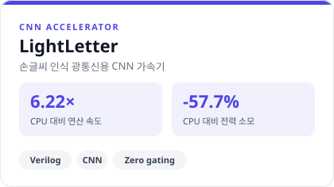</a></td>
    <td><a href="https://github.com/kimdh315/rv32i_pipeline">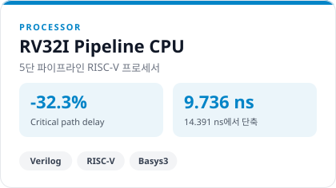</a></td>
  </tr>
  <tr>
    <td><a href="https://github.com/kimdh315/uart_fifo_uvm">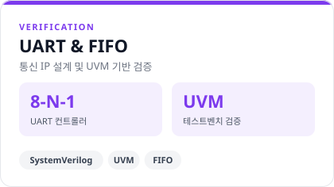</a></td>
    <td><a href="https://github.com/kimdh315/soc_axi_microblaze">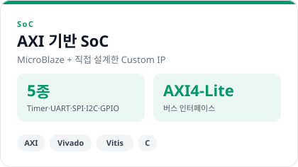</a></td>
  </tr>
  <tr>
    <td><a href="https://github.com/kimdh315/vga_camera">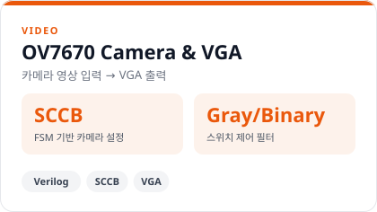</a></td>
    <td><a href="https://github.com/kimdh315/body_and_workout_check">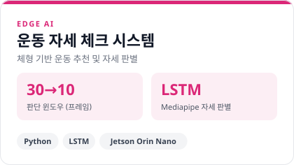</a></td>
  </tr>
</table>

카드를 클릭하면 해당 저장소로 이동합니다.

---

## 프로젝트 기술서

### 01. [Light Letter](https://github.com/mumallaeng/LightLetter) 

<table>
<tr>
<td width="50%" valign="top">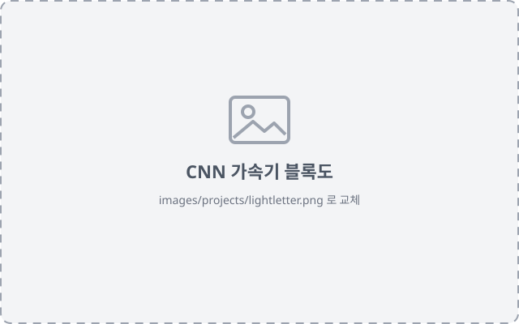</td>
<td width="50%" valign="top">

**기간** &nbsp; 2026.09 – 2026.10 
**역할** &nbsp; 손글씨 인식을 위한 CNN 가속기 설계 
**기술** &nbsp; `Verilog RTL` `C` `Python`

> **CPU 대비 6.22× 빠른 연산 전력 소모 57.7% 절감**

**목표** &nbsp; 전자파 간섭과 보안 문제가 있는 전파 통신 대신 광통신으로 정보를 전달하고, 전달 수단으로 손글씨 인식 AI 사용

</td>
</tr>
<tr>
<td colspan="2">

**문제 해결 — Zero gating & skipping**
- ReLU 출력과 입력 이미지에 0 값이 많다는 점에 주목
- 0과의 곱연산은 불필요하다고 판단해 해당 연산을 생략하도록 설계
- 기존 가속기 대비 **속도 12.3% 향상, 전력 소모 5% 감소**

**배운 점** &nbsp; 논문을 구현하는 데서 나아가, 설계 중 발견한 문제의 해결책을 직접 찾아 적용하는 경험

</td>
</tr>
</table>

### 02. [AI 기반 자세 및 운동 교정](https://github.com/kimdh315/body_and_workout_check)

<table>
<tr>
<td width="50%" valign="top">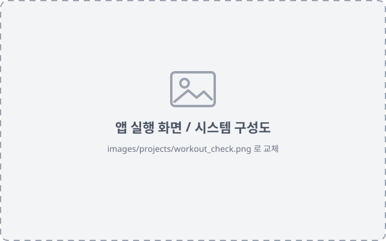</td>
<td width="50%" valign="top">

**기간** &nbsp; 2026.08 
**역할** &nbsp; Mediapipe·LSTM 기반 운동 종류 검출 
**기술** &nbsp; `Python` `LSTM` `Mediapipe` `Jetson Orin Nano`

> **K-Fold 적용으로 운동 인식 정확도 98%**

**목표** &nbsp; 웹캠 영상으로 체형을 분석해 맞춤 운동을 처방하고, 운동 자세를 실시간으로 판별하는 데스크톱 앱 구현

</td>
</tr>
<tr>
<td colspan="2">

**문제 해결 — TensorRT 연동 중 Segmentation fault**
- 다른 Jetson에서 만든 TRT 엔진을 그대로 쓰면서 메모리 매핑이 달라 발생한 문제임을 확인
- ONNX 파일을 기반으로 사용 보드에서 직접 엔진을 변환해 호환성 문제 해결

**배운 점** &nbsp; 컴퓨터 비전, LLM, LSTM을 하나의 실시간 앱으로 통합하고, 모델 추론의 안정성과 이식성 문제를 해결하는 방법

</td>
</tr>
</table>

### 03. [AXI4-Lite 기반 SoC 설계](https://github.com/kimdh315/soc_axi_microblaze)

<table>
<tr>
<td width="50%" valign="top">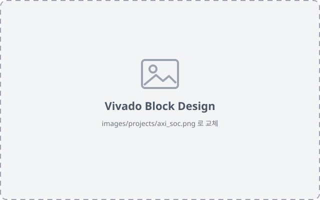</td>
<td width="50%" valign="top">

**기간** &nbsp; 2026.06 
**역할** &nbsp; AXI4-Lite Slave Custom IP 5종 설계 및 C 기반 제어 
**기술** &nbsp; `Verilog RTL` `UVM` `Vivado` `Vitis` `Basys3`

> **GPIO · SPI · UART · I2C · Timer Custom IP 5종 RTL 직접 설계**

**목표** &nbsp; MicroBlaze SoC에서 주변장치를 RTL로 직접 설계하고, 검증부터 C 애플리케이션 구동까지 HW/SW 풀스택 완성

</td>
</tr>
<tr>
<td colspan="2">

**문제 해결 — I2C polling 제어 문제**
- AXI로 I2C Master를 제어할 때 연속적인 동작 흐름 때문에 인터럽트 기반 동작이 어려움
- I2C transaction 모듈을 추가로 설계해 인터럽트 기반으로 동작하도록 구조 변경

**배운 점** &nbsp; AMBA 버스 프로토콜 계층과 인터럽트를 직접 구현하며 RTL 설계와 C 드라이버가 맞물리는 지점을 체득

</td>
</tr>
</table>

### 04. [RV32I Pipeline CPU 설계](https://github.com/kimdh315/rv32i_pipeline)

<table>
<tr>
<td width="50%" valign="top">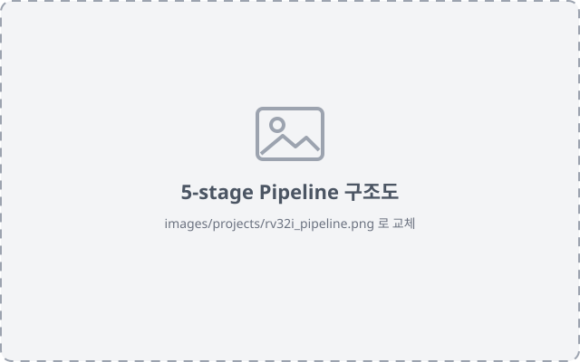</td>
<td width="50%" valign="top">

**기간** &nbsp; 2026.05 – 2026.06 
**역할** &nbsp; Pipeline CPU 전체 및 Hazard controller 설계 
**기술** &nbsp; `Verilog RTL` `Vivado` `Basys3`

> **Critical path delay 14.391 → 9.736 ns 최대 동작 속도 32.3% 개선**

**목표** &nbsp; Single-cycle 구조의 setup time violation을 해결하기 위해 RV32I 5-stage Pipeline CPU를 Harvard 구조로 설계

</td>
</tr>
<tr>
<td colspan="2">

**문제 해결**
- **Setup time violation** : 5-stage 파이프라인으로 critical path를 분할하고, Hazard controller로 파이프라인 hazard 제어
- **LH/LHU 하프워드 로드 버그** : 워드 내 상/하위 하프워드 선택 오류를 `dm_addr[1]` 비트로 오프셋을 분기해 해결

**배운 점** &nbsp; ISA가 하드웨어로 구현되는 과정을 이해하고, 구조 개선으로 타이밍 문제를 해결하는 방법

</td>
</tr>
</table>

### 05. SAR ADC 설계

<table>
<tr>
<td width="50%" valign="top">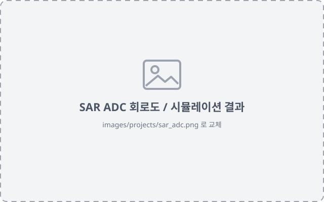</td>
<td width="50%" valign="top">

**기간** &nbsp; 2024.09 – 2024.11 
**역할** &nbsp; 팀장 · Bootstrapped switch 설계 및 전체 통합 
**기술** &nbsp; `Virtuoso`

> **10bit resolution · 101.6 µW 전체 팀 중 최고 성능 지표**

**목표** &nbsp; Monotonic 기법을 적용해 저전력·고해상도로 동작하는 SAR ADC 설계

</td>
</tr>
<tr>
<td colspan="2">

**문제 해결 — CDAC 전압 노이즈**
- 노이즈가 입력 전압에 따라 변하는 것을 보고, switch의 기생 커패시턴스가 원인임을 확인
- 차동 신호라는 점을 이용해 Cross-coupled capacitor를 추가해 노이즈 개선

**배운 점** &nbsp; MOSFET 수준에서 회로를 설계하고, 의도하지 않은 노이즈를 분석해 해결하는 역량

</td>
</tr>
</table>

---

<!-- ## AI 활용

### [UVM 자동 생성](https://github.com/kimdh315/auto_uvm_gen.git)
- Python으로 UVM 보일러플레이트 코드를 자동 생성하여, 검증 로직과 무관한 반복 코딩 최소화

--- -->

## 연락처

- **Email** : kimdh01315@gmail.com
- **GitHub** : https://github.com/kimdh315

---

각 프로젝트의 시뮬레이션 파형과 FPGA 리소스 리포트는 해당 저장소의 README에서 확인할 수 있습니다.
